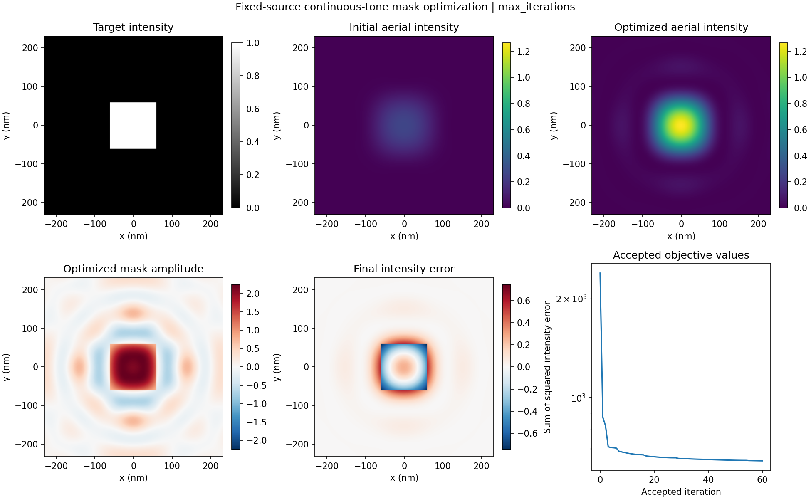

# Computational lithography in Python

Scalar Abbe imaging and continuous-tone mask optimization, based on
*Computational Lithography* by Xu Ma and Gonzalo R. Arce.

The optimizer adjusts a real, unconstrained mask amplitude under a fixed
source to minimize squared error between the aerial image and a target
intensity.



The figure uses 60 iterations. The mask is an unconstrained real amplitude.

## Run

Requires Python 3.10 or later. From the repository root:

```bash
python -m venv .venv
source .venv/bin/activate
python -m pip install -e .
python run_mask_optimization.py --iterations 500
```

On Windows PowerShell, activate the environment with
`.venv\Scripts\Activate.ps1`.

The installed `comp-litho` command runs the same example.

The default target is a 60 × 60 pixel square. The optical settings are:

| Parameter | Value |
| --- | --- |
| Wavelength / NA | 193 nm / 1.25 |
| Pixel spacing / image size | 2 nm / 231 × 231 |
| Kernel size | 461 × 461 (full input/output displacement range) |
| Source lattice | 18 × 18 |
| Annular source | Sigma 0.89–0.99 |

The run saves `summary.png`, `arrays.npz`, `parameters.json`, and `metrics.json`
in `results/mask_optimization/`. The arrays include the target, mask, aerial
images, and accepted loss history. Use `--output PATH` to change the directory
or `--initial-step VALUE` to change the initial line-search step.

## Code

| File | Contents |
| --- | --- |
| `imaging.py` | Abbe imaging model and mask gradient |
| `pupil_reference.py` | Independent frequency-space quadrature for validation |
| `optimization.py` | Gradient descent and line search |
| `run_mask_optimization.py` | Example target, command-line options, and saved results |

## Model and optimizer

The image is an incoherent sum of source-point intensities. Each coherent
kernel is the circular-pupil Bessel response with its physical area prefactor
and an illumination phase ramp. The default kernel includes every displacement
between mask and image pixels. FFT padding preserves linear convolution on the
output region; the mask is opaque outside the simulated field.

An independent frequency-space pupil calculation checks optical accuracy.
For the recorded square-opening example, the relative intensity difference
is about 0.01%. See the [comparison](docs/model.md#independent-optical-check)
and [metrics](docs/pupil_validation.json).

The [model notes](docs/model.md) give the sampling convention, kernel
normalization, and real-mask gradient.

Optimization uses gradient descent with Armijo backtracking. `metrics.json`
records the stopping status, accepted iterations, rejected steps, and final
gradient norm. The [stopping conditions](docs/model.md#stopping-conditions)
are described in the model notes.

## Python API

```python
from imaging import ImagingModel
from optimization import gradient_descent
from run_mask_optimization import make_target

model = ImagingModel()
target = make_target(model.image_size)
result = gradient_descent(
    lambda mask: model.loss_and_gradient(mask, target),
    target,
    max_iterations=100,
)
```

Pass `source_weights` to `ImagingModel` to use a custom source. The weights
must be nonnegative intensities on the model's source lattice. Optical
parameters and cached kernels are read-only; construct a new model to change
them.

## Tests

```bash
python -m unittest discover -s tests -v
```

The tests compare FFT and direct convolution, check adjoints and finite-difference
gradients, and cover asymmetric sources, image boundaries, rejected steps,
stopping conditions, and repeatability.

GitHub Actions runs the suite on Python 3.10 and 3.12. The recorded dependency
versions are in `requirements-reference.txt` for Python 3.12. Install those
first, then use `python -m pip install --no-deps -e .`.
