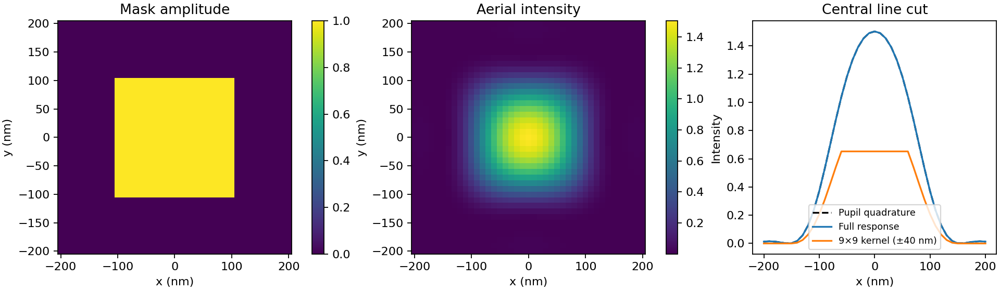

# Imaging model and gradient

The model computes one coherent field per source point, then sums their
intensities with nonnegative source weights. Lengths are in nm and spatial
frequencies in cycles/nm. Arrays use `(y, x)` order.

## Circular pupil and mask sampling

A unit circular pupil has cutoff `fc = NA / wavelength_nm`. Its continuous
coherent impulse response is

$$
h(r)=2\pi f_c^2\frac{J_1(2\pi f_c r)}{2\pi f_c r},\qquad
h(0)=\pi f_c^2.
$$

Each mask sample contributes its amplitude times `pixel_size_nm**2`; this is
a midpoint quadrature of the mask integral. The default kernel contains every
displacement between an input and output pixel: `2 * image_size - 1` samples
on each axis. There is no additional radial cutoff and no normalization by
the sum of a finite kernel.

The mask is zero outside the image. Finite-field diffraction and boundary
ripples are therefore part of the calculation. Changing the field of view
changes that physical aperture. Reducing pixel spacing at fixed physical
geometry checks the mask quadrature error.

For source frequency `(fy, fx)`, the sampled kernel is

$$
K_s(x,y)=\Delta x^2 h(\sqrt{x^2+y^2})
        \exp[2\pi i(f_y y+f_x x)].
$$

The source lattice spacing is `1 / (image_size * pixel_size_nm)`. An axis
of length `N` uses `arange(N) - (N - 1) / 2`, so even source lattices have
half-integer coordinates. Sigma is source radius divided by `fc`. Custom
`source_weights` replace the annulus on that same lattice; weights are copied
and normalized to unit total intensity. Sampling must resolve the shifted
pupil, including the active source frequencies.

An explicitly supplied smaller, odd `kernel_size` truncates the response.
It is available for comparisons; the resulting optical error must be checked
for the chosen mask. Its physical prefactor stays the same.

## FFT evaluation and adjoint

Signed kernel displacements are embedded in a circulant array with at least
`2 * image_size - 1` samples on each axis. That extent keeps every input/output
pair distinct. The mask occupies the first `image_size` samples, with zero
padding elsewhere; the output is cropped to that same region. Kernel FFTs
are cached, and one mask FFT is shared across source points.

For a real mask `m`, target intensity `T`, and source weights `w_s`,

$$
u_s=K_s m,\qquad I=\sum_s w_s|u_s|^2,\qquad
L=\sum_{i,j}(I_{ij}-T_{ij})^2,
$$

$$
\nabla_m L=4\sum_s w_s\operatorname{Re}
\left[K_s^H((I-T)u_s)\right].
$$

The adjoint zero-pads the residual field, multiplies by the conjugated kernel
transform, and crops to the mask region. Boundary and asymmetric-source tests
compare this derivative with finite differences.

The mask amplitude is real and unconstrained: negative values and values above
one are allowed. The objective uses aerial intensity directly, with fixed
illumination and no resist or mask-manufacturing constraints.

## Independent optical check

`pupil_reference.py` integrates the mask spectrum directly over a circular
pupil using NumPy matrix products. It uses neither the Bessel response nor an
FFT. `python examples/validate_pupil.py` compares the two calculations and
writes the figure and metrics in `docs/`. The tests also check convergence of
the pupil quadrature and of mask sampling for a fixed physical opening.

## Optimizer

Armijo backtracking accepts finite trial states with sufficient loss decrease.
A failed search returns the last accepted state. The result records accepted
losses, gradient norms, step sizes, evaluations, and rejected trials.

| Status | Stopping condition |
| --- | --- |
| `gradient_tolerance` | Maximum absolute gradient reaches the tolerance |
| `relative_loss_tolerance` | Change between accepted losses reaches the tolerance |
| `max_iterations` | Iteration budget exhausted; `converged` is false |
| `line_search_failed` | All trial steps rejected; `converged` is false |
